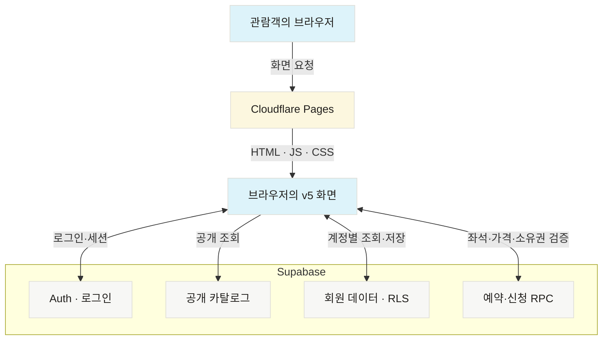

# 세종문화회관 리뉴얼

**공연을 발견하고, 관람을 준비하고, 나의 문화 기록을 남기는 웹사이트.**

Sejong Center Renewal · Next.js, React, TypeScript · Active version **v5**

**[실제 웹사이트](https://renewsejongpac.rhee.life/v5/)** · [디자인 시스템](https://renewsejongpac.rhee.life/v5/design-rules/) · [문서 지도](docs/README.md) · [운영·변경 이력](docs/operations/2026-11-04-cloudflare-transition-history.md)

| 화면과 인터랙션 | 인증과 데이터 | 빌드와 실서비스 |
| :---: | :---: | :---: |
| [](https://renewsejongpac.rhee.life/v5/) | [](https://supabase.com/) | [](https://developers.cloudflare.com/pages/) |
| Next.js · React · TypeScript | Supabase Auth · PostgreSQL | Cloudflare Pages |

## 바로 둘러보기

| 하고 싶은 일 | 진입점 | 살펴볼 내용 |
| --- | --- | --- |
| 공연 찾기 | [홈](https://renewsejongpac.rhee.life/v5/) · [프로그램](https://renewsejongpac.rhee.life/v5/programs/) | Swiper 히어로, 날짜·분류 탐색, 공연 상세 |
| 관람 준비 | [이용 안내](https://renewsejongpac.rhee.life/v5/visit/) | 공간·좌석·교통·접근성·관람 예절 |
| 나의 기록 | [나의 공간](https://renewsejongpac.rhee.life/v5/account/) | 로그인, 관심 공연, 관람노트, 미니룸 |
| 구현 확인 | [디자인 시스템](https://renewsejongpac.rhee.life/v5/design-rules/) | 제품과 가이드가 공유하는 컴포넌트·토큰·상태 |

## 지금의 운영 상태

| 항목 | 현재 상태 |
| --- | --- |
| 활성 제품 | `v5/`, 기본 경로 `/v5/` |
| 실서비스 | **Cloudflare Pages** - `renewsejongpac.rhee.life` → `renewsejongpac.pages.dev` |
| 지속 배포 | GitHub `main` 푸시 → DB 조회 → 정적 빌드 → Cloudflare 공개 |
| 데이터·로그인 | **Supabase** - 공개 카탈로그, 인증, 회원 기록, 예약·신청 RPC |
| 이전 Vercel 프로젝트 | **삭제 확인 완료** - 사용자 삭제 후 동일 프로젝트 조회 404·팀 목록 부재 확인 |
| 이전 화면 | 루트 버전 선택과 `v2/`·`v3/`·`v4/` 보존 |

확인 시점은 **2026-11-04 KST**다. 호스팅 전환, Vercel 삭제 전후 상태와 실제 배포 커밋은 [운영 이력](docs/operations/2026-11-04-cloudflare-transition-history.md)에 남긴다. DB를 Cloudflare D1으로 이전한 구성은 아니다.

## 구현한 경험과 범위

| 영역 | 구현 내용 | 데이터·제약 |
| --- | --- | --- |
| 프로그램 탐색 | 공연·전시·교육, 날짜·분류 필터, 상세 정보 | Supabase 공개 카탈로그와 정적 경로 |
| 홈 히어로 | **Swiper 12.2 내장**, 750ms 전환, 터치·반복·재생 제어 | 외부 Swiper CDN 없이 번들. 모션 감소·초점·가시성 처리 |
| 개인 공간 | 관심 공연, 관람노트, 예매 기록, 미니룸 | 로그인한 계정의 DB 기록과 소유권 검증 |
| 관람 예약 | 회차·좌석 조회, 5분 보류, 30분 미결제 예약, 취소·만료 | 확인된 회차·좌석도·가격에서만 활성화 |
| 신청·문의 | 양식별 접수와 문의, 상품·장바구니 | 계정별 저장과 서버 검증 |
| 공통 UI | 버튼·입력·표면·유리 패널·퀵메뉴·텍스트 | 같은 등록 컴포넌트를 제품과 가이드에서 사용 |

**예약 엔진과 결제·발권은 구분한다.** PG 결제와 실제 티켓 발권은 연결하지 않았다. 2026-11-04의 읽기 전용 DB 확인에서 공개 회차는 0개였다. 회차가 없다는 사실을 예약 로직 미구현이나 결제 완료로 바꾸어 표현하지 않는다.

## 시스템 구조

[](https://renewsejongpac.rhee.life/docs/readme/system-overview.svg)

위 SVG를 열면 **회원 저장·콘텐츠 발행·전체 흐름**을 선택할 수 있다. 키보드 조작·움직임 정지·모션 감소도 지원한다. GitHub README 안에서는 이미지로 표시되므로 조작은 독립 SVG에서 한다.



[확대 SVG](docs/readme/diagrams/runtime-overview.svg) · [Mermaid 원본](docs/readme/diagrams/runtime-overview.mmd) · [구조·데이터 경계 상세](docs/architecture/overview.md)

### 데이터가 DB와 파일에 함께 있는 이유

| 자료 | 원본 | 파일의 역할 |
| --- | --- | --- |
| 공연·공간·페이지·공지 | Supabase 공개 콘텐츠 | 빌드 스냅샷과 HTML을 생성하고 브라우저에서 갱신 |
| 관심 공연·노트·신청 | 인증한 계정의 DB 기록 | 조회·저장 클라이언트 코드와 접근 규칙 |
| 색상·타입·컴포넌트 계약 | TypeScript 소스 | 버전 관리와 자동 검사 |
| 스키마 변경 | 마이그레이션과 실제 DB | 관계·권한·RPC 변경 이력 |

공개 DB 조회가 실패하면 정식 빌드는 중단된다. 생성 스냅샷과 `out/`을 수동으로 편집하거나 다른 데이터를 성공한 갱신으로 표시하지 않는다. 새 프로그램 경로는 다시 빌드해야 하며, 브라우저 갱신은 이미 내보낸 정적 경로의 범위를 지킨다.

## 데이터 관계 / Database relationships

전체 ERD는 [데이터 모델 문서](docs/architecture/data-model.md)로 옮겼다. 운영 메타데이터와 마이그레이션을 대조해 공개 콘텐츠·회원/예약·신청/장바구니·채팅의 네 영역을 구분한다.

| 모델 | 그림과 근거 |
| --- | --- |
| 공개 콘텐츠 | [공연·공간·편성 ERD](docs/architecture/data-model.md#1-공연과-공개-콘텐츠--programs-and-published-content) |
| 회원·좌석·예약 | [계정과 재고·예약 ERD](docs/architecture/data-model.md#2-회원과-좌석-예약--members-and-seat-reservations) |
| 접수·상품 | [신청·장바구니 ERD](docs/architecture/data-model.md#3-신청문의와-장바구니--service-requests-and-cart) |
| 채팅 관련 구조 | [현재 DB와 저장소 이력의 차이](docs/architecture/data-model.md#4-채팅-스레드와-호출량) |

`FK`는 실제 외래 키를 뜻한다. 관심 공연·관람노트의 텍스트 프로그램 식별자나 채팅 호출량에 없는 FK를 설명 편의로 그리지 않는다.

## 내 컴퓨터에서 실행 / Run locally

**Node.js 24.x**와 npm을 사용한다. 아래는 macOS·Linux·일반 터미널 예제이며, PowerShell에서는 `npm`·`npx` 대신 `npm.cmd`·`npx.cmd`를 사용할 수 있다.

```sh
git clone https://github.com/hslcrb/renewsejongpac.git
cd renewsejongpac/v5
npm ci
```

`v5/.env.local`에 자신의 Supabase **공개 클라이언트 설정**을 둔다. 이 파일은 커밋하지 않는다.

```dotenv
NEXT_PUBLIC_SUPABASE_URL=https://YOUR_PROJECT_REF.supabase.co
NEXT_PUBLIC_SUPABASE_ANON_KEY=YOUR_PUBLISHABLE_OR_ANON_KEY
```

```sh
npm run dev -- --hostname 127.0.0.1
```

[로컬 홈](http://127.0.0.1:3000/v5/) · [로컬 디자인 시스템](http://127.0.0.1:3000/v5/design-rules/)

주소에 `/v5/`가 필요하다. 로그인에는 Supabase 제공자와 복귀 URL 설정도 필요하다. Google Client Secret과 서비스 역할 키는 브라우저 설정에 넣지 않는다. [인증 설정·실행 절차](CONTRIBUTING.md#인증과-환경-설정--authentication-and-environment)를 따른다.

## 검증과 배포

### 로컬 검사

문서만 바꾸면 링크·Mermaid·SVG를 검사한다. 제품을 바꾸면 관련 검사와 전체 단위 검사·타입 검사·정적 빌드를 수행한다. 개발 서버와 생산 빌드는 같은 `.next/`를 쓰므로 동시에 실행하지 않는다.

```sh
cd v5
npm run check:system
npx tsc --noEmit --pretty false
npm run build
node scripts/audit-static-export.ts
```

전체 단위 검사 명령과 Windows 예제는 [기여 안내](CONTRIBUTING.md#무엇을-검사하나요--verification)에 있다. 새 `out/`과 v5 루트 미러 파일은 `.gitignore`로 제외한다. 기존 커밋된 정적 산출물은 삭제하거나 추적 해제하지 않는다. [브라우저 검사](v5/docs/optional-browser-checks.md)는 선택사항이다.

### 실서비스로 가는 경로

[](https://renewsejongpac.rhee.life/docs/readme/diagrams/deployment-pipeline.svg)

Cloudflare Pages는 `main` 푸시마다 다음 명령을 실행한다.

```sh
npm ci --prefix v5 && npm run build --prefix v5 && node v5/scripts/cloudflare-stage.ts
```

출력 디렉터리는 `v5/.cloudflare-output`이다. **푸시 성공·빌드 성공·실제 공개는 서로 다른 확인 단계**다. 생산 배포의 SHA와 실제 도메인의 화면·자산을 확인한 뒤 배포 완료로 기록한다.

[상세 배포 절차·장애 구분](docs/operations/deployment-runbook.md) · [배포 Mermaid 원본](docs/readme/diagrams/deployment-pipeline.mmd) · [검증·변경 역사](docs/operations/2026-11-04-cloudflare-transition-history.md)

## 개발 지도

```text
README.md                   프로젝트의 입구
docs/README.md              독자별 문서 지도
docs/architecture/          시스템·데이터 흐름·ERD
docs/operations/            배포 절차·실제 확인 근거·변경 역사
docs/readme/                SVG·Mermaid 원본·자산 출처
v5/app/                     현재 화면 경로
v5/components/              재사용 제품 컴포넌트
v5/src/catalog/             공개 DB 조회·정적 경로 제한
v5/src/data/                디자인 토큰·등록부·탐색 계약
v5/src/lib/                 인증·회원 기록·예약·신청 연결
v5/styles/                  공통 규격과 레이아웃
v5/supabase/migrations/     스키마·권한·RPC의 변경 이력
v5/scripts/                 생성·감사·빌드·배포 준비
v5/tests/                   단위·브라우저 검사
v5/out/                     전체 정적 내보내기
v2/ · v3/ · v4/             보존한 이전 버전
```

## 디자인 시스템

같은 역할은 같은 컴포넌트를 쓰고, 다른 용도는 공식 베리언트로 표현한다. 페이지마다 버튼·입력·본문 규격을 새로 만들지 않는다.

| 계약 | 소스 |
| --- | --- |
| 최소 16px 텍스트와 공유 위계 | [디자인 토큰](v5/src/data/design-tokens.ts), `SystemText`, `data-text` |
| 오프화이트·오프블랙, 옅은 안쪽 경계 | [생성 토큰 CSS](v5/styles/tokens.css) |
| 버튼·입력·표면 | [SystemPrimitives](v5/components/SystemPrimitives.tsx), `SystemSurface` |
| 등록·실사용·가이드 일치 | [컴포넌트 연결표](v5/docs/component-connections.md) |
| 퀵메뉴·유리 표면 | [퀵메뉴 안내](v5/docs/components/violet-quick-menu.md), `LiquidGlass` |

퇴역한 `BookingInvitation`은 이력만 보존한다. 현재 홈의 ‘관람 예약’ 제목은 정적인 텍스트다.

## 기여와 기록

모든 사람과 모델은 **작업 브랜치**를 사용한다. 검토한 변경은 새 PR 없이 `--no-ff` merge commit으로 main에 통합한다. 다른 사람의 변경이나 과거 기록을 덮어쓰지 않는다.

커밋 제목은 `**<현재브랜치명>** <영어 type>: <구체적인 한국어 설명>`이다. 상세 절차는 [CONTRIBUTING](CONTRIBUTING.md), [코딩 헌법](CODING_CONSTITUTION.md)를 따른다.

| 다음으로 읽을 문서 | 목적 |
| --- | --- |
| [문서 지도](docs/README.md) | 이용자·개발자·운영자의 읽기 경로 |
| [시스템 구조와 요청 흐름](docs/architecture/overview.md) | 콘텐츠·인증·예약의 실행 경계 |
| [데이터 모델](docs/architecture/data-model.md) | 실제 FK·RLS·현재 DB와 이력의 차이 |
| [운영 절차](docs/operations/deployment-runbook.md) | 설정·정식 빌드·배포 확인·문제 분류 |
| [전환·삭제·구현 전체 이력](docs/operations/2026-11-04-cloudflare-transition-history.md) | Swiper와 Cloudflare 전환, 잘못된 판단의 정정, Vercel 삭제 확인 |
| [문서 자산 출처·재생성](docs/readme/ASSETS.md) | SVG·Mermaid를 다시 만들고 확인하는 방법 |
| [v5 개발 안내](v5/README.md) · [LLM Reference](LLM_REFERENCE.md) | 현재 제품 소스와 작업 규칙 |
