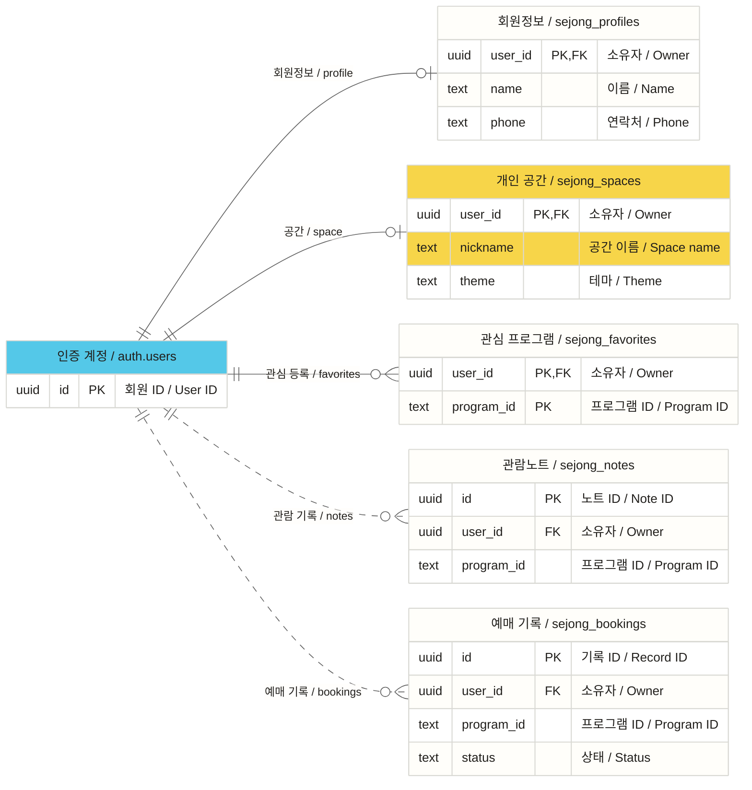

# 세종문화회관 리뉴얼 / Sejong Center Renewal

공연을 발견하고, 관람을 준비하고, 나의 문화생활을 기록하는 웹사이트입니다. 현재 개발 대상은 `v5/`이며, 이전 버전은 같은 저장소에 보존합니다.

A website for discovering performances, planning a visit, and keeping a personal record of cultural experiences. Active development lives in `v5/`; earlier versions remain available in this repository.

[웹사이트 / Website](https://renewsejongpac.rhee.life/v5/) · [디자인 시스템 / Design system](https://renewsejongpac.rhee.life/v5/design-rules/) · [디자인·회원 DB 계약 / Design and member-data contract](v5/docs/visual-contract-and-member-db.md)

## 구현 현황 / What is implemented

| 영역 / Area | 한국어 | English |
| --- | --- | --- |
| 프로그램 / Programs | 공연·전시·교육 탐색, 검색·필터, 상세 화면, 양옆 작품이 보이는 히어로 | Performance, exhibition, and education discovery; search, filters, detail pages, and a hero with neighboring works |
| 방문·대관 / Visits and rentals | 관람 일정 선택, 방문 계획, 공간 비교, 이용 안내 | Date selection, visit planning, venue comparison, and visitor information |
| 계정 / Accounts | Supabase Google OAuth와 이메일 로그인 링크, PKCE 복귀 처리 | Supabase Google OAuth and email sign-in links with a PKCE callback |
| 나의 공간 / Personal space | TSX 미니룸, 회원정보, 관심 프로그램, 관람노트, 예매 기록 | An authored TSX mini room, member profile, favorites, notes, and booking records |
| 회원 데이터 / Member data | PostgreSQL 저장과 RLS 기반 회원별 접근 제한 | PostgreSQL persistence with per-member Row Level Security |
| 공통 UI / Shared UI | 텍스트·컨트롤·둥근 표면·Liquid Glass·알림 컴포넌트 | Shared typography, controls, rounded surfaces, Liquid Glass, and notifications |

예매 화면은 선택한 회차·좌석·금액의 기록과 취소를 지원합니다. PG 결제, 실제 좌석 재고 연동, 티켓 발행은 구현 범위에 포함되지 않습니다.

The booking flow saves selected sessions, seats, and amounts, and supports cancelling those records. Payment processing, live seat inventory, and ticket issuance are not integrated.

## 실행 / Getting started

Node.js **24.x**와 npm을 사용합니다. 개발·빌드 스크립트와 테스트는 Node의 기본 type stripping으로 TypeScript를 직접 실행합니다.

Use Node.js **24.x** and npm. Development, build, and test scripts execute TypeScript directly using Node's built-in type stripping.

```bash
git clone https://github.com/hslcrb/renewsejongpac.git
cd renewsejongpac/v5
npm ci
```

`v5/.env.local`에 Supabase 프로젝트의 공개 설정을 입력합니다. 이 파일은 커밋하지 않습니다.

Create `v5/.env.local` with your Supabase project's public configuration. Keep this file out of Git.

```dotenv
NEXT_PUBLIC_SUPABASE_URL=https://YOUR_PROJECT_REF.supabase.co
NEXT_PUBLIC_SUPABASE_ANON_KEY=YOUR_PUBLISHABLE_OR_LEGACY_ANON_KEY
```

```bash
npm run dev -- --hostname 127.0.0.1
```

| 화면 / Page | 개발 주소 / Development URL |
| --- | --- |
| 홈 / Home | <http://127.0.0.1:3000/v5/> |
| 디자인 시스템 / Design system | <http://127.0.0.1:3000/v5/design-rules/> |
| 마이페이지 / Account | <http://127.0.0.1:3000/v5/account/> |

Next.js의 `basePath`는 `/v5`입니다. 브라우저에서도 이 경로를 포함해야 합니다.

The Next.js `basePath` is `/v5`; include that prefix when opening development pages.

## 회원 데이터 ERD / Member-data ERD

운영 마이그레이션의 핵심 키와 관계를 발췌했습니다. 하늘색은 인증 계정, 노랑은 개인 공간, 웜 화이트는 회원 기록입니다. 각 엔티티에 한국어 이름과 실제 테이블 이름을 함께 표시합니다.

This ERD shows key fields and relationships from the deployed migration. Sky blue identifies the authenticated user, yellow the personal space, and warm white member records. Each entity includes its Korean name and physical table name.



| 테이블 / Table | 저장 내용 / Stored data | 회원과의 관계 / Per user |
| --- | --- | --- |
| `sejong_profiles` | 이름·이메일·연락처 / Name, email, and phone | 0 또는 1 / Zero or one |
| `sejong_spaces` | 공간 이름·한마디·테마·조명 / Space name, message, theme, and lighting | 0 또는 1 / Zero or one |
| `sejong_favorites` | 관심 프로그램 ID / Favorite program IDs | 0 이상, 회원·프로그램 조합 고유 / Zero or more; unique per user and program |
| `sejong_notes` | 프로그램·관람일·본문 / Program, event date, and note body | 0 이상 / Zero or more |
| `sejong_bookings` | 프로그램·제목·장소·회차·좌석·금액·상태 / Program, title, venue, session, seats, amount, and status | 0 이상 / Zero or more |

- 모든 `user_id`는 `auth.users.id`를 참조하며 계정 삭제 시 관련 행도 삭제됩니다. / Every `user_id` references `auth.users.id` with cascading deletion.
- RLS는 `auth.uid() = user_id`를 확인합니다. 익명 접근과 다른 회원으로의 소유자 변경을 차단합니다. / RLS enforces `auth.uid() = user_id`, denies anonymous access, and prevents ownership reassignment.
- `program_id`는 [TypeScript 카탈로그](v5/src/data/catalog.ts)의 식별자이며 프로그램 DB 테이블의 외래 키가 아닙니다. / `program_id` identifies an entry in the [TypeScript catalog](v5/src/data/catalog.ts); it is not a foreign key to a program database table.
- 인증 세션은 Supabase SDK가 관리하고, 회원 데이터의 원본은 DB입니다. / The Supabase SDK manages authentication sessions; member records are stored in the database.

전체 필드·제약·정책은 [마이그레이션 SQL](v5/supabase/migrations/20261021075737_v5_member_data.sql), 실제 소유권 검사는 [롤백 검증 SQL](v5/supabase/tests/member-ownership.sql), 운영 적용 결과는 [DB 검증 기록](v5/docs/member-db-live-verification.json)을 참고하세요.

See the [migration SQL](v5/supabase/migrations/20261021075737_v5_member_data.sql) for all fields, constraints, and policies; the [transactional ownership test](v5/supabase/tests/member-ownership.sql) for isolation checks; and the [live verification report](v5/docs/member-db-live-verification.json) for deployment evidence.

## 인증 설정 / Authentication setup

Google Client ID와 Client Secret은 **Supabase의 Google 제공자 설정**에 입력합니다. 브라우저용 환경 변수에는 Supabase의 공개 키만 사용합니다.

Configure the Google Client ID and Client Secret in the **Supabase Google provider settings**. Only the Supabase public key belongs in browser-facing environment variables.

| 설정 / Setting | 값 / Value |
| --- | --- |
| Google 승인 리디렉션 URI / Google authorized redirect URI | `https://<PROJECT_REF>.supabase.co/auth/v1/callback` |
| Supabase 앱 복귀 URL / Application redirect URL | `https://<APP_HOST>/v5/account/callback/` |
| 로컬 개발 복귀 URL / Local development redirect URL | `http://127.0.0.1:3000/v5/account/callback/` |

Google 제공자와 이메일 로그인을 활성화하고 앱 복귀 URL을 Supabase 허용 목록에 등록합니다. 로컬·운영·미리보기 주소는 각각 등록합니다.

Enable Google and email sign-in and allow application callback URLs in Supabase. Register development, production, and preview addresses separately.

## 디자인 시스템 / Design system

제품 화면과 가이드가 같은 컴포넌트를 사용합니다. 색상과 규격은 TypeScript 원본에서 생성하며, 페이지별 CSS는 배치를 담당합니다.

Product pages and the guide use the same components. Colors and specifications are generated from TypeScript definitions; page-level CSS handles layout.

| 기준 / Contract | 구현 / Implementation |
| --- | --- |
| 텍스트 최소 16px / Minimum 16px text | `SystemText`, `textAttributes`, `data-text` |
| 공통 둥근 표면 / Shared rounded surfaces | `SystemSurface` |
| 버튼·링크·입력 / Buttons, links, and fields | `SystemPrimitives`, `SystemNavigation`, `SystemDialog` |
| 유리 재질 / Glass materials | `LiquidGlass`: `surface`, `drawer`, `hero`, `black` |
| 소형 상태 알림 / Small status notifications | `SmallNotificationModal` with the `black` glass variant |
| 이전 글자 모션 / Retired letter motion | `BookingInvitation` - `Deprecated`; guide example only |

| 컬러 / Color | 토큰 / Token | 값 / Value |
| --- | --- | --- |
| 어스 블랙 / Earth black | `--color-black` | `#211F1C` |
| 웜 화이트 / Warm white | `--color-white` | `#FFFEFA` |
| 하늘 / Sky | `--color-sky` | `#54C8E8` |
| 노랑 / Yellow | `--color-yellow` | `#F7D549` |
| 황토 / Ochre | `--color-ochre` | `#C36D15` |

원본은 [디자인 토큰](v5/src/data/design-tokens.ts)과 [컴포넌트 등록부](v5/src/data/component-registry.ts)에 있습니다. 변경할 때 제품과 가이드를 함께 확인합니다.

The sources of truth are the [design tokens](v5/src/data/design-tokens.ts) and [component registry](v5/src/data/component-registry.ts). Review both product pages and guide examples when changing them.

## 빌드·검증 / Build and verification

아래 명령은 `v5/`에서 실행합니다. 변경에 관련된 검사를 먼저 실행하고, 제품 소스를 수정했다면 마지막에 전체 검사와 정적 빌드를 수행합니다.

Run these commands from `v5/`. Start with checks relevant to the change; finish product-code changes with the full test suite and static build.

```bash
npm run check:system
npx tsc --noEmit
node --test tests/*.test.mjs tests/*.test.ts
npm run build
```

빌드 전 디자인 계약을 검사하고 이전 빌드 디렉터리를 정리합니다. Next.js 정적 내보내기는 `v5/out/`에 생성되며, [sync-out.ts](v5/scripts/sync-out.ts)가 배포 파일을 `v5/` 루트에도 미러링합니다. 두 산출물을 모두 커밋합니다.

The prebuild step checks design contracts and cleans previous build directories. Next.js exports to `v5/out/`, and [sync-out.ts](v5/scripts/sync-out.ts) mirrors deployment files into the `v5/` root. Commit both outputs.

브라우저 검사는 Playwright Chromium을 사용합니다. 필요한 경우 `npx playwright install chromium`으로 설치하고 개발 서버나 빌드된 정적 서버를 먼저 실행합니다.

Browser checks use Playwright Chromium. Install it with `npx playwright install chromium` if needed, and start a development or static server first.

```bash
node tests/component-system-browser.ts http://127.0.0.1:3000/v5/
node tests/visual-contract-browser.ts http://127.0.0.1:3000/v5/
node tests/member-db-browser.ts http://127.0.0.1:3000/v5/
```

`member-db-browser.ts`는 실제 SDK와 모의 Auth·REST 응답을 사용합니다. 실제 DB의 RLS는 별도의 롤백 SQL로 검증하며 두 결과를 구분해 기록합니다.

`member-db-browser.ts` uses the real SDK with mocked Auth and REST responses. Verify live database RLS separately with the rollback SQL, and record those results separately.

[검증 결과 / Verification report](v5/docs/visual-contract-verification.json)

## 배포 / Deployment

[vercel.json](vercel.json)이 v5 설치·빌드와 `/v5/` 정적 경로를 설정합니다. Vercel 프로젝트 루트는 저장소 루트로 둡니다.

[vercel.json](vercel.json) defines v5 installation, building, and `/v5/` static routing. Use the repository root as the Vercel project root.

```bash
# 저장소 루트에서 실행 / Run from the repository root
python -m http.server 8000
```

빌드된 v5는 <http://localhost:8000/v5/>에서 확인합니다. Windows에서 `python` 대신 `py`, macOS·Linux에서 `python3`을 사용할 수 있습니다.

Open <http://localhost:8000/v5/> for the exported application. Use `py` on Windows or `python3` on macOS and Linux if appropriate.

## 저장소 구조 / Repository layout

```text
v5/
  app/                    Next.js 경로 / Routes
  components/             등록 UI·페이지 조합 / Registered UI and page composition
  src/data/               카탈로그·토큰·등록부 / Catalog, tokens, and registry
  src/lib/                인증·회원 DB·상태 / Auth, member database, and state
  styles/                 생성 토큰·공통·배치 스타일 / Generated tokens and styles
  scripts/                계약 검사·정적 미러링 / Contract checks and export mirroring
  supabase/migrations/    회원 스키마·RLS / Member schema and RLS
  supabase/tests/         실제 DB 소유권 검사 / Live ownership checks
  tests/                  단위·브라우저 검사 / Unit and browser checks
  public/                 공연 이미지·아이콘·폰트 / Program media, icons, and fonts
  docs/                   설계·검증 기록 / Design and verification records
  out/                    전체 정적 빌드 / Complete static export
index.html                버전 선택 / Version selector
legacy.html               초기 정적 버전 / Original static version
v2/, v3/, v4/             보존된 버전 / Preserved versions
vercel.json               배포 설정 / Deployment configuration
```

이전 버전의 안내는 [v2 디자인 문서](v2/docs/design-system.md), [v3 README](v3/README.md), [v4 README](v4/README.md)에 보존합니다. 버전 선택 화면은 루트 정적 서버에서 엽니다.

Earlier documentation remains in the [v2 design guide](v2/docs/design-system.md), [v3 README](v3/README.md), and [v4 README](v4/README.md). Open the version selector through the root static server.

## 협업·권한 / Collaboration and access

원본 저장소의 협업자는 읽기·편집·푸시 권한을 사용합니다. 개인 계정 저장소의 삭제와 접근 관리는 소유자 권한입니다. 보관용 비공개 미러는 별도 권한을 사용하며 협업자에게 공유하지 않습니다.

Source-repository collaborators can read, edit, and push. Repository deletion and access administration remain owner operations for a personal-account repository. The private archive mirror has separate access controls and is not shared with collaborators.

소유자 작업폴더의 `origin`에는 원본과 미러의 두 push URL이 설정되어 있습니다. 아래 명령은 그 작업폴더에서 두 저장소에 전송합니다. 이 설정은 `.git/config`에 있으므로 다른 clone에 자동 전달되지 않습니다.

The owner's working copy has two push URLs on `origin`, targeting the source and archive repositories. The command below pushes to both from that working copy. This configuration is local to `.git/config` and is not inherited by other clones.

```bash
git push origin main
```

커밋 메시지는 영어 접두사와 한국어 설명을 사용합니다. / Use an English prefix with a Korean description.

```text
docs: 프로젝트 안내와 회원 데이터 구조 정리
```

[저장소 작업 규칙 / Repository instructions](CONTRIBUTING.md) · [GitHub 개인 저장소 권한 / GitHub personal-repository permissions](https://docs.github.com/en/repositories/managing-your-repositorys-settings-and-features/repository-access-and-collaboration/permission-levels-for-a-personal-account-repository) · [Mermaid ERD 문법 / Mermaid ERD syntax](https://mermaid.js.org/syntax/entityRelationshipDiagram.html)
